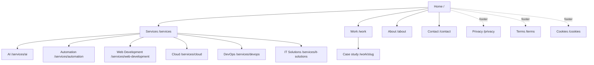
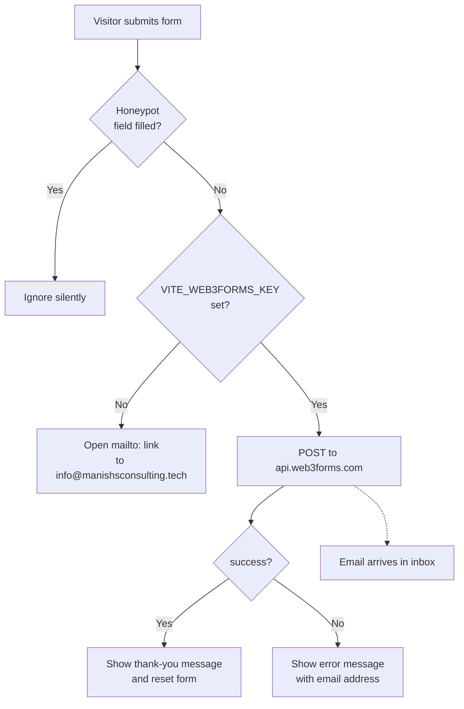
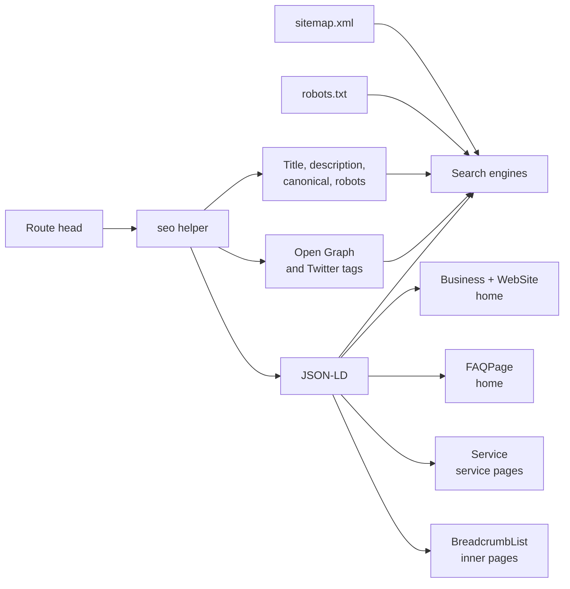
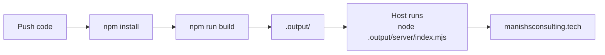

# Manish S Consulting

Website for **Manish S Consulting**, an independent IT consultancy in Pune, India offering AI solutions, automation, web development, cloud, DevOps and IT support.

Live site: <https://manishsconsulting.tech>

## Contents

- [Tech stack](#tech-stack)
- [Quick start](#quick-start)
- [Environment variables](#environment-variables)
- [Scripts](#scripts)
- [Architecture](#architecture)
- [Project structure](#project-structure)
- [Site map and routes](#site-map-and-routes)
- [Contact form flow](#contact-form-flow)
- [Editing content](#editing-content)
- [SEO](#seo)
- [Build and deployment](#build-and-deployment)
- [Before you go live](#before-you-go-live)

## Tech stack

| Area | Choice |
| --- | --- |
| Framework | [TanStack Start](https://tanstack.com/start) (React 19, SSR) with file-based routing |
| Language | TypeScript (strict) |
| Styling | Tailwind CSS v4, Radix UI primitives, lucide icons |
| Build | Vite 8, Nitro server output |
| Forms | [Web3Forms](https://web3forms.com), with a `mailto:` fallback |
| Tests | Vitest, Testing Library |

## Quick start

Requires Node.js 20+ and npm.

```sh
npm install
cp .env.example .env     # then fill in the values below
npm run dev              # http://localhost:8080
```

## Environment variables

Vite only exposes variables prefixed with `VITE_`. Set the same values in your hosting provider's environment settings, because `.env` is not deployed.

| Variable | Required | Purpose |
| --- | --- | --- |
| `VITE_WEB3FORMS_KEY` | Recommended | Access key from web3forms.com. Without it the contact form falls back to opening the visitor's email app. |
| `VITE_CAL_LINK` | Optional | Cal.com handle, e.g. `manishsharma/intro`. Empty means booking links fall back to the contact page. |

The Web3Forms key is safe to expose in the browser. It only permits submissions to the email address it was registered with.

## Scripts

| Command | What it does |
| --- | --- |
| `npm run dev` | Start the dev server on port 8080 |
| `npm run build` | Production build into `.output/` |
| `npm run preview` | Preview the production build |
| `npm run lint` | Run ESLint |
| `npm run format` | Format with Prettier |
| `npm test` | Run tests once |
| `npm run test:watch` | Run tests in watch mode |

## Architecture

```mermaid
flowchart LR
    V[Visitor browser] -->|HTTPS| N[Nitro server]
    G[Googlebot] -->|HTTPS| N
    N --> S[server.ts<br/>SSR error wrapper]
    S --> T[TanStack Start<br/>router + SSR]
    T --> R[Route components<br/>src/routes]
    R --> C[Content files<br/>src/content]
    R --> L[SEO helpers<br/>src/lib/seo.ts, schema.ts]
    T -->|HTML + JSON-LD| V
    T -->|sitemap.xml| G
    V -->|form POST| W[(Web3Forms API)]
    W -->|email| I[info@manishsconsulting.tech]
```

Pages are rendered on the server, so crawlers receive complete HTML with titles, canonical links and structured data. The browser then hydrates the page into a normal React app.

## Project structure

```text
.
├── public/                  Static files served as-is
│   ├── robots.txt           Crawl rules and sitemap pointer
│   ├── site.webmanifest     Web app manifest
│   ├── og-image.png         1200x630 social share image
│   └── icon-*, favicon-*    Icons, logo and profile images
├── src/
│   ├── routes/              One file per page (file-based routing)
│   │   ├── __root.tsx       Document shell, global meta, 404 and error pages
│   │   ├── sitemap[.]xml.tsx  Generated sitemap endpoint
│   │   └── ...              index, about, contact, services.*, work.*, legal pages
│   ├── components/
│   │   ├── site/            Header, footer, hero, page sections, LegalPage
│   │   └── ui/              Radix-based UI primitives
│   ├── content/             All site copy and data (see "Editing content")
│   ├── lib/                 seo.ts, schema.ts, images.ts, error handling
│   ├── assets/              Images bundled by Vite
│   ├── server.ts            Server entry with SSR error handling
│   ├── start.ts             Request middleware (error handling, CSRF)
│   └── styles.css           Tailwind setup and theme tokens
├── vite.config.ts           Plugins, dev port, security and cache headers
└── .env.example             Environment variable template
```

## Site map and routes



| Route | Source file |
| --- | --- |
| `/` | `src/routes/index.tsx` |
| `/services`, `/services/:slug` | `services.index.tsx`, `services.$slug.tsx` |
| `/work`, `/work/:slug` | `work.index.tsx`, `work.$slug.tsx` |
| `/about`, `/contact` | `about.tsx`, `contact.tsx` |
| `/privacy`, `/terms`, `/cookies` | `privacy.tsx`, `terms.tsx`, `cookies.tsx` |
| `/sitemap.xml` | `sitemap[.]xml.tsx` |

Service and case-study pages are generated from the data files in `src/content`, so adding an entry there creates the page.

## Contact form flow



WhatsApp is a plain link (`wa.me`) with a pre-filled message, defined as `whatsappUrl` in `src/content/site.ts`.

## Editing content

Text lives in `src/content`, not in the page components.

| File | What it controls |
| --- | --- |
| `site.ts` | Business name, email, WhatsApp link, location, social links, navigation, canonical `siteUrl` |
| `services.ts` | The six services and their page content |
| `projects.ts` | Case studies (currently demo placeholders) |
| `faq.ts` | FAQ entries, shown on the home page and in FAQ structured data |
| `process.ts` | Process steps, guarantees and "not the right fit" list |
| `credentials.ts` | Results, differentiators and certifications used on the home page |
| `legal.ts` | Privacy Policy, Terms of Service and Cookie Policy text |

Case studies marked `isPlaceholder: true` are excluded from search indexing and the sitemap. Replace them with real engagements and set the flag to `false`.

## SEO



- Every route calls `seo()` from `src/lib/seo.ts` in its `head`, so titles, descriptions and canonical URLs are set in one place.
- Structured data is built in `src/lib/schema.ts` and rendered as JSON-LD.
- `/sitemap.xml` is generated from the same content files as the pages.
- 404 pages return a real 404 status and are `noindex`.
- Security and cache headers are set in `vite.config.ts`.

## Build and deployment



`npm run build` produces a Node server in `.output/`. Run it with:

```sh
node .output/server/index.mjs
```

To target another platform (Cloudflare, Vercel, Netlify), set a preset in `vite.config.ts`, for example `nitro({ preset: "vercel" })`. Remember to set the environment variables on the host.

## Before you go live

1. Set `VITE_WEB3FORMS_KEY` on the host, using a key registered to `info@manishsconsulting.tech`.
2. Point `manishsconsulting.tech` at the host, enable HTTPS, and redirect `www` to the bare domain.
3. Add the site in Google Search Console and Bing Webmaster Tools, then submit `https://manishsconsulting.tech/sitemap.xml`.
4. Create a Google Business Profile and use the exact name "Manish S Consulting" on LinkedIn, GitHub and directories.
5. Replace the demo case studies with real ones.
6. Have the legal pages reviewed by a lawyer.
